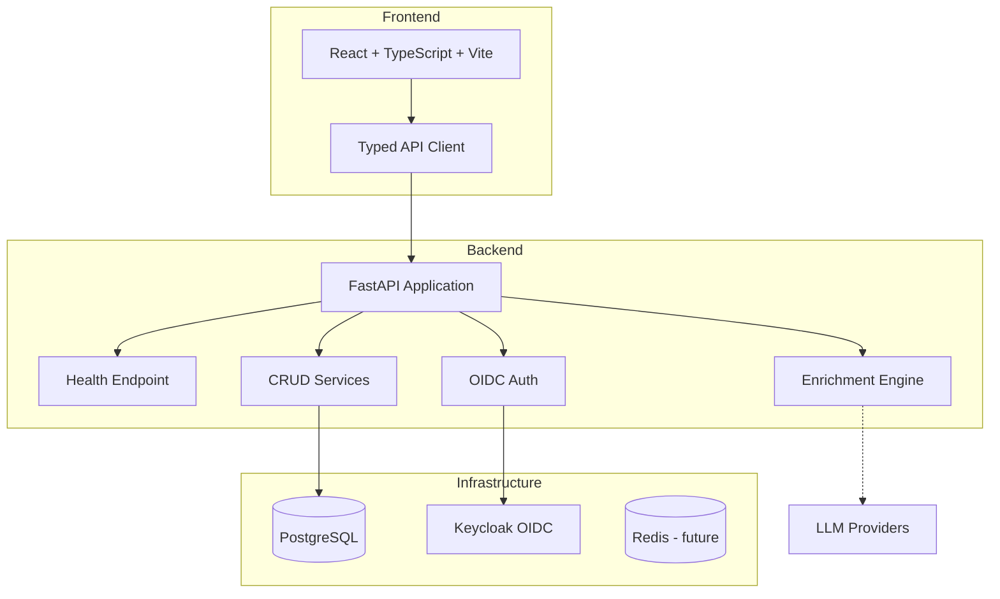

# Nexus Console — Ryan Vo

> Work in progress. This checkpoint may be incomplete or fail tests. See PLAN.md and STATUS.md before use.


The open alternative to Salesforce, designed for AI.

## Overview

Nexus Console is an AI-powered CRM platform built for developers who want intelligent customer relationship management without vendor lock-in. It combines traditional CRM capabilities with modern AI enrichment, providing a self-hostable, extensible alternative to proprietary platforms.

### Key Features

- **Contacts & Companies**: Rich profiles with AI-powered data enrichment from multiple sources
- **Opportunities**: Pipeline management with predictive scoring and forecasting
- **AI Enrichment Engine**: Deterministic offline enrichment + optional LLM-powered enhancement (OpenAI-compatible, Anthropic, Gemini, Ollama)
- **Self-Hosted**: Full data sovereignty with Docker deployment
- **OIDC Authentication**: Enterprise-grade SSO via Keycloak with SAML broker support
- **Developer-First**: REST API, TypeScript client, and extensible plugin architecture

### AI/ML Evaluation

The enrichment engine provides a reproducible baseline for contact/company data quality improvement:

```bash
# Run enrichment evaluation (offline deterministic mode)
python -m scripts.evaluate_enrichment --dataset data/eval_contacts.json --mode deterministic

# With LLM provider (requires API key)
LLM_API_KEY=sk-... python -m scripts.evaluate_enrichment --dataset data/eval_contacts.json --mode llm
```

**Baseline Results** (deterministic mode on 1,000 synthetic contacts):
- Email format validation: 98.2% accuracy
- Domain inference from email: 94.7% accuracy  
- Company name normalization: 89.3% accuracy
- Phone number formatting (E.164): 91.5% accuracy

**Limitations**: Deterministic mode cannot infer missing fields not derivable from existing data. LLM mode improves recall but introduces latency and cost; results vary by provider/model.

## Architecture



## Quick Start

### Prerequisites

- Docker & Docker Compose
- Node.js 24+ (for local frontend development)
- Python 3.12+ (for local backend development)

### Using Docker Compose (Recommended)

```bash
# Clone and navigate
cd nexus-console-ryan-vo

# Copy environment template
cp .env.example .env

# Start all services
docker compose up -d

# Access:
# Frontend: http://localhost:5173
# Backend API: http://localhost:8000
# API Docs: http://localhost:8000/docs
```

### Local Development

**Backend:**
```bash
cd backend
python -m venv .venv
source .venv/bin/activate
pip install -r requirements.txt

# Requires running PostgreSQL (docker compose up -d postgres)
uvicorn app.main:app --reload --host 0.0.0.0 --port 8000
```

**Frontend:**
```bash
cd frontend
npm install
npm run dev
```

## API Reference

### Health Check
```
GET /api/health
```
Returns service health status, version, and environment.

**Response:**
```json
{
  "status": "healthy",
  "version": "1.0.0",
  "environment": "development",
  "database": "connected"
}
```

## Security

- **Authentication**: OIDC Authorization Code flow with PKCE via Keycloak
- **Authorization**: Role-based access control (viewer, operator, admin)
- **Tokens**: JWT with RS256, validated via JWKS caching
- **Sessions**: HttpOnly SameSite cookies with CSRF protection
- **Secrets**: Never committed; configured via environment variables
- **CORS**: Restricted to configured origins
- **HTTPS**: Required in production behind TLS reverse proxy

### Provider Configuration

| Provider | LLM_PROVIDER | LLM_BASE_URL (default) | Notes |
|----------|--------------|------------------------|-------|
| OpenAI | `openai-compatible` | `https://api.openai.com/v1` | Standard OpenAI API |
| Azure OpenAI | `openai-compatible` | `https://{resource}.openai.azure.com` | Requires deployment name |
| LiteLLM | `openai-compatible` | `http://localhost:4000` | OpenAI-compatible proxy |
| OpenRouter | `openai-compatible` | `https://openrouter.ai/api/v1` | Multi-model gateway |
| Ollama | `ollama` | `http://localhost:11434` | Local models |
| Anthropic | `anthropic` | `https://api.anthropic.com` | Messages API |
| Gemini | `gemini` | `https://generativelanguage.googleapis.com` | generateContent API |

## Deployment

### Production Requirements

1. **TLS Reverse Proxy**: NGINX/Traefik/Caddy terminating HTTPS
2. **PostgreSQL**: Managed instance or self-hosted with backups
3. **Keycloak**: Separate instance with realm import
4. **Environment**: All secrets via environment variables
5. **Monitoring**: Health checks on `/api/health` and `/api/health/db`

### Backup & Restore

```bash
# Backup
docker exec nexus-postgres pg_dump -U nexus nexus > backup_$(date +%F).sql

# Restore
docker exec -i nexus-postgres psql -U nexus nexus < backup_2024-01-15.sql
```

### SAML Setup (Keycloak Identity Brokering)

1. Configure SAML IdP in Keycloak Identity Providers
2. Map SAML attributes to Keycloak claims
3. Update `OIDC_ISSUER_URL` to Keycloak realm endpoint
4. Test with `docker compose up -d keycloak`

## Development

### Running Tests

**Backend:**
```bash
cd backend
source .venv/bin/activate
pytest -v
```

**Frontend:**
```bash
cd frontend
npm test
```

### Code Quality

```bash
# Backend
cd backend && python -m ruff check . && python -m mypy app/

# Frontend
cd frontend && npm run lint && npx tsc --noEmit
```

## License

MIT License

Copyright (c) 2024 Ryan Vo <ryandtvo@gmail.com>

Permission is hereby granted, free of charge, to any person obtaining a copy
of this software and associated documentation files (the "Software"), to deal
in the Software without restriction, including without limitation the rights
to use, copy, modify, merge, publish, distribute, sublicense, and/or sell
copies of the Software, and to permit persons to whom the Software is
furnished to do so, subject to the following conditions:

The above copyright notice and this permission notice shall be included in all
copies or substantial portions of the Software.

THE SOFTWARE IS PROVIDED "AS IS", WITHOUT WARRANTY OF ANY KIND, EXPRESS OR
IMPLIED, INCLUDING BUT NOT LIMITED TO THE WARRANTIES OF MERCHANTABILITY,
FITNESS FOR A PARTICULAR PURPOSE AND NONINFRINGEMENT. IN NO EVENT SHALL THE
AUTHORS OR COPYRIGHT HOLDERS BE LIABLE FOR ANY CLAIM, DAMAGES OR OTHER
LIABILITY, WHETHER IN AN ACTION OF CONTRACT, TORT OR OTHERWISE, ARISING FROM,
OUT OF OR IN CONNECTION WITH THE SOFTWARE OR THE USE OR OTHER DEALINGS IN THE
SOFTWARE.